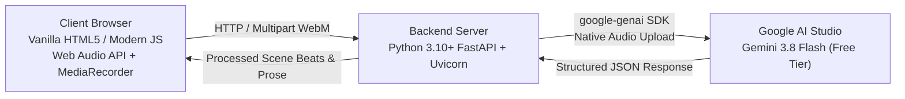
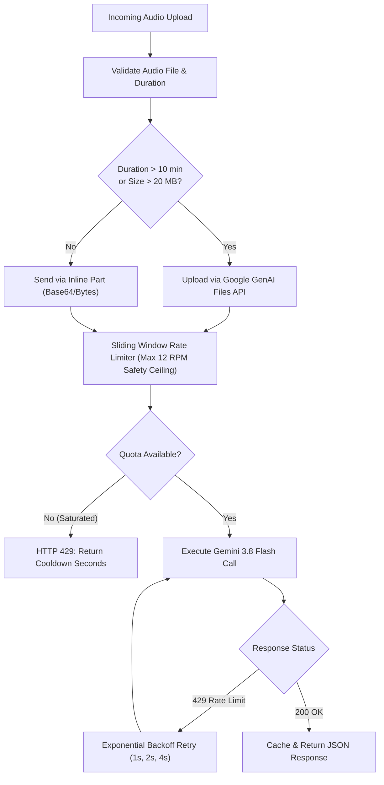

# Arc Scribe - System Architecture

Architectural specification for Arc Scribe, a dedicated audio-to-novel scene transcription and drafting tool for collaborative web novelists.

---

## 1. Executive Summary & Vision

Web novelists often outline and write collaboratively by verbally roleplaying dialogues between characters. In this creative setup, two creators act out character interactions live in real-time.

**Arc Scribe** solves the capture and synthesis problem:

- Captures live, unscripted vocal performances between two speakers in high fidelity.
- Sends native audio to Google AI Studio's active free-tier model: **Gemini 3.8 Flash** (`gemini-3.8-flash`, configurable via `GEMINI_MODEL`).
- Performs dual-speaker identification (Speaker 1 vs Speaker 2) mapped to assigned character personas (e.g., Lord Vane vs Ethan).
- Transcribes verbatim dialogue while preserving nuanced emotional inflection cues (e.g., whispering, stuttering, vocal fry, sudden outburst, suppressed weeping).
- Structures dialogue into novel chapter beats, character motivations, and initial draft prose suitable for web novel publication.

---

## 2. Technical Stack Selection & Justification

To avoid the dependency bloat, fragile build steps, and gigabyte-sized `node_modules` folders typical of modern SPA frameworks, Arc Scribe is built on a streamlined, production-grade micro-stack:



### Stack Components

| Layer | Technology | Rationale |
| :--- | :--- | :--- |
| **Frontend UI** | Modern Vanilla HTML5, CSS3, JavaScript (ES2022) | Zero bundle step, zero npm dependencies, runs instantly in any browser. Sub-millisecond load times. |
| **Audio Capture** | Browser Web Audio API (`navigator.mediaDevices.getUserMedia` & `MediaRecorder`) | Native browser support for Opus-encoded WebM audio, microphone input gain control, live visualizer canvas. |
| **Backend API** | Python 3.10+ with FastAPI & Uvicorn | Lightweight asynchronous web server, type validation via Pydantic, seamless integration with AI libraries. |
| **AI Engine** | Gemini 3.8 Flash (`gemini-3.8-flash` via `google-genai` SDK) | Active free-tier model with native multimodal audio comprehension, acoustic tone recognition, and fast inference. |
| **Storage / State** | In-Memory Sliding Window + Local Filesystem JSON cache | Session resilience without requiring Redis, PostgreSQL, or external database overhead. |

---

## 3. Detailed Audio Capture & Processing Pipeline

The audio capture pipeline is designed to be frictionless for writers performing an improv session:

```mermaid
sequenceDiagram
    autonumber
    actor Writer1 as Speaker 1 (Older Brother)
    actor Writer2 as Speaker 2 (Younger Brother)
    participant UI as Arc Scribe Web Client
    participant Rec as MediaRecorder (WebM/Opus)
    participant API as FastAPI Backend (/api/process-audio)
    participant AI as Gemini 3.8 Flash Free Tier

    Writer1->>UI: Selects Character 1 ("Lord Vane") & vocal notes
    Writer2->>UI: Selects Character 2 ("Ethan") & vocal notes
    Writer1->>UI: Clicks "Record Scene"
    UI->>Rec: mediaRecorder.start(timeslice=1000)
    Writer1->>Rec: Speaks dialogue with emotional inflection
    Writer2->>Rec: Responds in character with emotional cues
    Writer1->>UI: Clicks "Stop & Transcribe"
    Rec->>UI: onstop event yields Blob (audio/webm)
    UI->>API: POST /api/process-audio (FormData: audio, metadata)
    API->>API: Validate file size & MIME type (audio/webm;codecs=opus)
    API->>API: Check Rate Limit Token Bucket (15 RPM / 1M TPM)
    API->>AI: client.models.generate_content(model='gemini-3.8-flash', contents=[audio, prompt])
    AI-->>API: Structured JSON (Diarization, Cues, Beats, Draft)
    API-->>UI: 200 OK + Scene JSON payload
    UI->>UI: Render Split View: Verbatim Script & Draft Prose
```

### Audio Specifications

- **Container & Codec**: `audio/webm;codecs=opus` (Chrome/Firefox/Edge) or `audio/mp4;codecs=aac` (Safari).
- **Audio Channels**: Mono (1 channel) or Stereo (2 channels), 48,000 Hz sample rate.
- **Bitrate**: 64 kbps to 128 kbps (crystal clear voice recording with minimal payload size: ~0.5 MB to 1 MB per minute).
- **Session Duration**: Ideal session chunk is 1 to 15 minutes per scene (under 15 MB), fitting directly into Gemini's single inline payload or Files API upload.

---

## 4. Speaker Diarization via Gemini 3.8 Flash

Gemini 3.8 Flash possesses native acoustic and phonemic understanding. Unlike traditional speech-to-text models (e.g., standard Whisper) that require a separate diarization pipeline (like pyannote.audio or clustering algorithms), Gemini processes raw audio waveforms directly alongside textual system instructions.

### Diarization Strategy

1. **Acoustic Profiling**:
   - The user interface provides character configuration cards before recording.
   - Writers specify physical voice traits for each brother (e.g., Speaker 1: deeper register, measured baritone, slower cadence; Speaker 2: higher pitch, rapid tempo, breathy delivery).

2. **Persona Mapping**:
   - The system prompt maps acoustic speaker profiles to novel character identities:
     - `Speaker 1` $\rightarrow$ `Character A` (e.g., *Lord Vane, Ruthless Patriarch*)
     - `Speaker 2` $\rightarrow$ `Character B` (e.g., *Ethan, Rebellious Heir*)

3. **Paralinguistic Cue Extraction**:
   - Gemini analyzes the audio stream not just for words, but for acoustic features:
     - Pitch variation, volume dynamics, speech rate, pauses, sighs, vocal tension.
   - Gemini tags these cues in square brackets or parentheticals: `(whispering with suppressed fury)`, `(stammering, voice cracking)`, `(sharp scoff followed by bitter laughter)`.

4. **Overlap & Cross-Talk Resolution**:
   - In live acting, brothers frequently interrupt or speak over one another.
   - The model is instructed to output overlapping sections with explicit markers (`[interrupted by Ethan]`) or interleaved line beats to preserve dramatic tension.

---

## 5. Free-Tier Rate-Limit Safeguards & Resilience

Google AI Studio's Gemini 3.8 Flash / 3.5 Flash Free Tier provides generous quotas, but strict limits must be governed by backend safeguards:

### Gemini 3.8 Flash Free Quota Limits

- **15 RPM** (Requests Per Minute)
- **1,000,000 TPM** (Tokens Per Minute)
- **1,500 RPD** (Requests Per Day)
- **Context Window**: 1,048,576 tokens (~11 hours of audio)
- **Audio Tokenization Rate**: Approximately 25-32 tokens per second of audio (~1,500 to 1,920 tokens per minute of audio).

### Implemented Safeguards



1. **Sliding Window Token Bucket**:
   - The backend enforces a local ceiling of 12 requests per minute (leaving 3 RPM headroom below the 15 RPM limit).
   - If consecutive scene recordings are fired rapidly, requests enter a queuing queue with automated countdown feedback sent to the client.

2. **Audio Duration Budgeting**:
   - 1 minute of audio = ~1,800 tokens.
   - Even a 30-minute dialogue session is only ~54,000 tokens, well below the 1,000,000 TPM ceiling.
   - For audio longer than 15 minutes, Arc Scribe automatically utilizes the Gemini Files API (`client.files.upload`), cleaning up temporary files after generation.

3. **Exponential Backoff with Jitter**:
   - If Google AI Studio returns an HTTP 429 or 503 error, the backend retries with full jitter up to 3 times before returning an error to the frontend.

4. **Client-Side Storage Backup**:
   - The recorded audio Blob is held in browser IndexedDB memory until the transcription successfully returns. If an API call fails, the writer never loses their improv audio.

---

## 6. System Directory Structure

The project directory `d:\Trinno\arc-scribe` is structured cleanly into documentation, backend services, and static frontend assets:

```text
d:\Trinno\arc-scribe\
├── .env.example              # Template for GEMINI_API_KEY and server configuration
├── .gitignore                # Git exclusions (audio cache, .env, __pycache__)
├── requirements.txt          # Python minimal dependencies (fastapi, uvicorn, google-genai)
├── main.py                   # FastAPI server entry point and endpoint routing
├── docs/                     # Technical specifications and architectural documents
│   ├── ARCHITECTURE.md       # Complete system architecture and pipeline
│   ├── API_SPECS.md          # REST API contracts, SDK usage, and payload formats
│   └── PROMPT_TEMPLATES.md   # Tested prompts for diarization and scene generation
├── backend/
│   ├── __init__.py
│   ├── config.py             # Settings and environment variables loader
│   ├── gemini_client.py      # Google GenAI SDK wrapper and rate-limit guard
│   ├── models.py             # Pydantic schemas for request/response payloads
│   └── rate_limiter.py       # Sliding-window in-memory rate limiter
└── frontend/
    ├── index.html            # Single-page interface (split-screen recording & script editor)
    ├── style.css             # Modern typography, dark/light theme, audio visualizer styling
    └── app.js                # MediaRecorder controller, Web Audio visualizer, API connector
```

---

## 7. Security and Data Flow Compliance

- **API Key Security**: The Google AI Studio API key is kept strictly server-side inside `.env`. It is never exposed to the client browser.
- **Local Audio Privacy**: Audio files are processed in-memory or in temporary system storage (`/temp`) and deleted immediately after Gemini inference completes.
- **No Third-Party Analytics**: No external telemetry, tracking, or heavy third-party CDNs are loaded, ensuring maximal performance and creative privacy.
